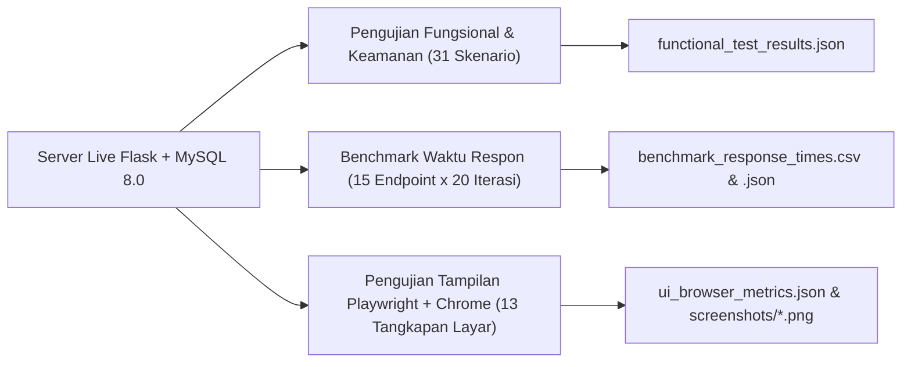
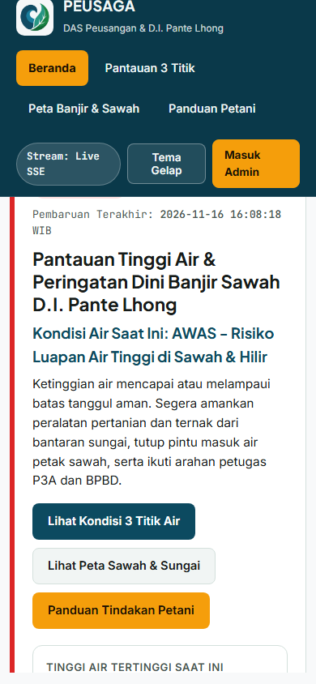
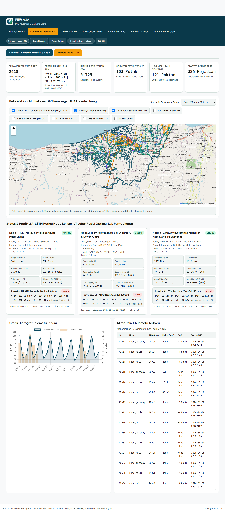
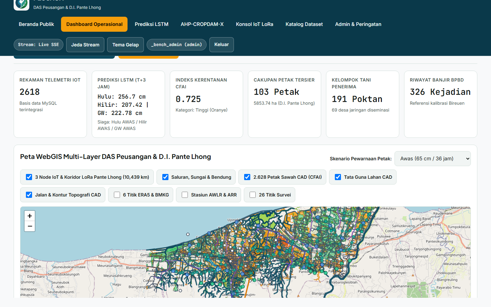
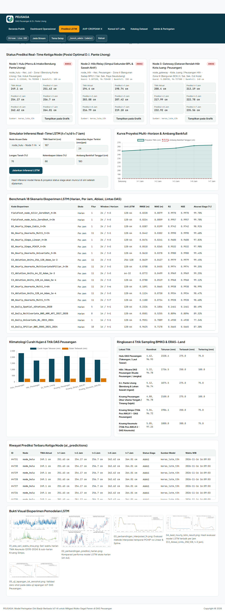
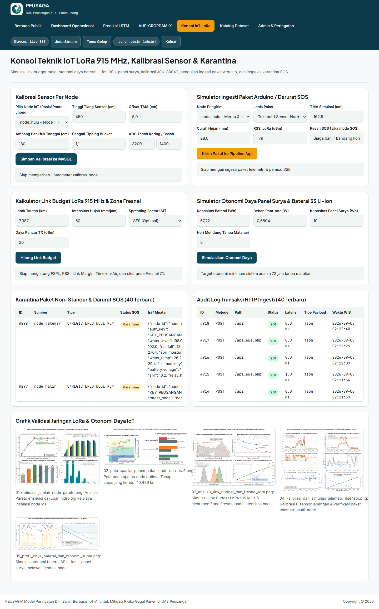
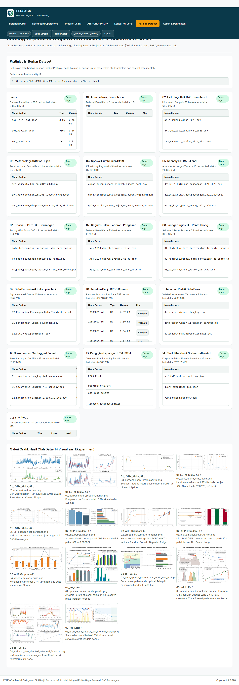
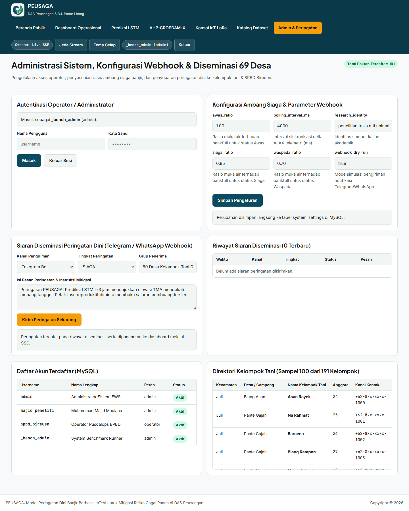

# Laporan Pengujian Sistem PEUSAGA Fullstack

- **Waktu Eksekusi**: 2026-11-16 16:09:50 WIB
- **Lingkungan Pengujian**: Python 3.12, Flask + SQLAlchemy, MySQL 8.0, TensorFlow/Keras, Leaflet `L.canvas()`, Google Chrome Headless
- **Ringkasan Kelulusan Fungsional**: **31/31 Kasus Uji LULUS** (`exit_code=0`, durasi `81.23 detik`)

## 1. Arsitektur Alur Pengujian Sistem

Metrik persentil ke-95 ($P_{95}$) untuk distribusi waktu respon $L = \{l_1, l_2, \dots, l_n\}$ yang telah diurutkan dihitung menggunakan interpolasi linier:

$$P_{95} = l_{\lfloor k \rfloor} + (k - \lfloor k \rfloor) \cdot (l_{\lceil k \rceil} - l_{\lfloor k \rfloor}), \quad k = 0.95 \cdot (n - 1)$$

## 2. Hasil Benchmark Waktu Respon (N = 20 Iterasi per Endpoint)
| Metode | Endpoint | Deskripsi | HTTP | Payload | Min (ms) | Rata-rata (ms) | Median (ms) | P95 (ms) | Maks (ms) |
| :--- | :--- | :--- | :---: | :---: | :---: | :---: | :---: | :---: | :---: |
| `GET` | `/` | Landing Page Publik | `200` | 18,268 B | 20.08 | **21.51** | 21.73 | 22.23 | 22.89 |
| `GET` | `/login` | Halaman Login Admin | `200` | 21,977 B | 25.85 | **28.05** | 27.96 | 30.19 | 30.98 |
| `GET` | `/api/status` | API Publik Status 3 Node | `200` | 6,052 B | 9.40 | **10.07** | 10.06 | 10.79 | 11.09 |
| `GET` | `/api/gis/layers` | API WebGIS (103 Blok + 2.628 Sawah CAD) | `200` | 3,009,254 B | 108.91 | **121.82** | 120.01 | 134.88 | 163.16 |
| `GET` | `/api/gis/cad-extras` | API Lazy-Load CAD Sekunder | `200` | 4,718,341 B | 218.87 | **243.39** | 238.48 | 276.99 | 282.69 |
| `GET` | `/dashboard` | Dashboard Operasional WebGIS | `200` | 21,977 B | 18.35 | **19.15** | 18.93 | 20.05 | 20.71 |
| `GET` | `/ai-lstm` | Halaman Prediksi AI-LSTM | `200` | 47,702 B | 15.07 | **15.73** | 15.54 | 16.97 | 17.37 |
| `GET` | `/cropdamx` | Halaman Analisis AHP-CROPDAM-X | `200` | 73,564 B | 14.55 | **15.65** | 15.73 | 16.34 | 16.51 |
| `GET` | `/console` | Halaman Konsol Teknis & LoRa | `200` | 61,160 B | 15.81 | **16.95** | 16.78 | 17.94 | 18.71 |
| `GET` | `/datasets` | Halaman Katalog Dataset | `200` | 189,401 B | 958.18 | **1022.64** | 993.80 | 1133.11 | 1148.07 |
| `GET` | `/admin` | Halaman Administrasi & Kalibrasi | `200` | 36,015 B | 12.89 | **13.93** | 13.81 | 14.73 | 14.80 |
| `GET` | `/api/telemetry?limit=50` | API Telemetri Historis (50 baris) | `200` | 16,109 B | 8.55 | **9.26** | 9.26 | 9.85 | 9.95 |
| `POST` | `/api/predict` | API Inferensi Keras LSTM (node_hulu) | `200` | 361 B | 70.06 | **75.97** | 75.61 | 83.64 | 84.13 |
| `POST` | `/api/risk/cropdamx` | API Evaluasi & Surrogate AHP-CROPDAM-X | `200` | 1,456 B | 36.64 | **41.29** | 39.41 | 50.29 | 51.42 |
| `POST` | `/api/lora/link-budget` | API Kalkulator Link Budget LoRa | `200` | 300 B | 5.88 | **6.65** | 6.63 | 7.57 | 8.24 |

## 3. Hasil Pengujian Fungsional, Keamanan, AI & WebGIS
| No | Kasus Uji | Status | Rincian Hasil |
| :---: | :--- | :---: | :--- |
| 1 | Logo PNG Transparan | **PASS** | size=(512, 512), mode=RGBA, corner_alpha=0 |
| 2 | MySQL Baseline Seeding | **PASS** | parcels=103 (5853.74 ha), telemetry=2618, flood_events=326 |
| 3 | Posisi Baru 3 Node Pante Lhong | **PASS** | coords_ok=True, old_pos_count=0 |
| 4 | Prediksi Historis & Keras 3 Node | **PASS** | total_per_node={'node_gateway': 871, 'node_hilir': 873, 'node_hulu': 2837}, keras_per_node={'node_gateway': 1, 'node_hilir': 1, 'node_hulu': 89} |
| 5 | HTML Route / | **PASS** | HTTP 200, h1=1, emdash=False, svg=False, clean=True |
| 6 | Landing Page Humanize & Pemisahan Menu Pengunjung | **PASS** | humanized=True, admin_menu_leaked=False |
| 7 | HTML Route /login | **PASS** | HTTP 200, h1=1, emdash=False, svg=False, clean=True |
| 8 | Route Guard & Proteksi API Tanpa Login | **PASS** | redirects_302=True, unauth_api=[401,401,401,401] |
| 9 | API Publik Landing Page (/api/status) | **PASS** | HTTP=200, nodes=3, overall=AWAS |
| 10 | Ingesti JSON /api (Tanpa Login Browser) | **PASS** | {'alert_level': 'SIAGA', 'cfai_score': 0.2767, 'node_id': 'node_hulu', 'pred_plus_3h_cm': 164.56, 'risk_category': 'Rendah', 'status': 'ok', 'timestamp': '2026-11-16 16:07:07', 'water_level_cm': 157.4} |
| 11 | Ingesti Arduino CSV /api_ews.php | **PASS** | {'alert_level': 'SIAGA', 'cfai_score': 0.2767, 'node_id': 'node_hilir', 'pred_plus_3h_cm': 133.45, 'risk_category': 'Rendah', 'status': 'ok', 'timestamp': '2026-11-16 16:08:12', 'water_level_cm': 120.0} |
| 12 | Karantina SOS & Auth Hardware | **PASS** | SOS HTTP=202, Invalid HTTP=401 |
| 13 | Autentikasi Login Admin (/login) | **PASS** | bad=401, good_redirect=/dashboard |
| 14 | HTML Route /dashboard | **PASS** | HTTP 200, h1=1, emdash=False, svg=False, clean=True |
| 15 | Navbar Admin Setelah Login | **PASS** | Menu operasional dan tombol Keluar tampil saat sesi admin aktif |
| 16 | HTML Route /ai-lstm | **PASS** | HTTP 200, h1=1, emdash=False, svg=False, clean=True |
| 17 | HTML Route /cropdamx | **PASS** | HTTP 200, h1=1, emdash=False, svg=False, clean=True |
| 18 | HTML Route /console | **PASS** | HTTP 200, h1=1, emdash=False, svg=False, clean=True |
| 19 | HTML Route /datasets | **PASS** | HTTP 200, h1=1, emdash=False, svg=False, clean=True |
| 20 | HTML Route /admin | **PASS** | HTTP 200, h1=1, emdash=False, svg=False, clean=True |
| 21 | Keras LSTM & Simulasi 3 Node | **PASS** | t+3h={'node_hulu': 164.56, 'node_hilir': 133.45, 'node_gateway': 217.74}, sim_all=3 node |
| 22 | AHP-CROPDAM-X & Surrogate | **PASS** | CFAI=0.5901, RF=0.598, sigma=0.5747 |
| 23 | Filter Petak Tersier | **PASS** | matched=3 |
| 24 | WebGIS Multi-Layer Payload | **PASS** | iot_nodes=3, parcels=103, cad_sawah=2628, structures=137, channels=400, boundaries=364 |
| 25 | WebGIS CAD Extras Lazy-Load | **PASS** | status=200, pemukiman=1423, roads=1301 |
| 26 | Webhook Broadcast Dry-Run | **PASS** | SIMULATED OK |
| 27 | Kalkulator Teknik LoRa & Daya | **PASS** | RSSI=-98.68 dBm, autonomy=84.8h |
| 28 | Dataset Preview & Path Guard | **PASS** | csv=200, traversal_blocked=400, chart=200 |
| 29 | Logout Menghapus Sesi | **PASS** | logout=302, post_logout_dashboard=302 |
| 30 | Koordinat (X, Y) Peta WebGIS | **PASS** | Fungsi & label koordinat X/Y geografis + UTM 47N tersedia pada seluruh layer peta |
| 31 | Higienitas Kode & Keamanan Path | **PASS** | Bersih |

## 4. Metrik Antarmuka Browser & Responsivitas
| Berkas Tangkapan Layar | Halaman / Skenario | Viewport | Tema | DOM Ready (ms) | Load (ms) | Overflow (px) | Ukuran |
| :--- | :--- | :--- | :---: | :---: | :---: | :---: | :---: |
| `01_landing_light_desktop.png` | Landing Page Publik (Terang) | Desktop 1440x900 | Light | 1109 | 2503 | 0 | 1006.5 KB |
| `02_landing_dark_desktop.png` | Landing Page Publik (Gelap) | Desktop 1440x900 | Dark | 1109 | 2503 | 0 | 1017.6 KB |
| `04_login_desktop.png` | Halaman Login Admin | Desktop 1440x900 | Light | 51 | 51 | 0 | 70.3 KB |
| `03_landing_mobile.png` | Landing Page Publik (Mobile) | Mobile 390x844 | Light | 699 | 1606 | 0 | 68.6 KB |
| `05_dashboard_light_desktop.png` | Dashboard WebGIS (2.628 Sawah CAD) | Desktop 1440x900 | Light | 195 | 199 | 0 | 1094.5 KB |
| `06_dashboard_cad_extras_desktop.png` | Dashboard WebGIS (Lapisan CAD Lengkap) | Desktop 1440x900 | Light | 195 | 199 | 0 | 566.9 KB |
| `07_dashboard_dark_desktop.png` | Dashboard WebGIS (Tema Gelap) | Desktop 1440x900 | Dark | 195 | 199 | 0 | 1140.0 KB |
| `08_dashboard_mobile.png` | Dashboard WebGIS (Mobile) | Mobile 390x844 | Light | 74 | 76 | 192 | 59.6 KB |
| `09_ai_lstm_desktop.png` | Modul Prediksi AI-LSTM (3 Node) | Desktop 1440x900 | Light | 88 | 89 | 0 | 673.9 KB |
| `10_cropdamx_desktop.png` | Modul Risiko AHP-CROPDAM-X | Desktop 1440x900 | Light | 67 | 68 | 0 | 445.4 KB |
| `11_console_desktop.png` | Konsol Teknis & Link Budget LoRa | Desktop 1440x900 | Light | 64 | 65 | 0 | 511.2 KB |
| `12_datasets_desktop.png` | Katalog Dataset & Artefak Riset | Desktop 1440x900 | Light | 1236 | 1237 | 0 | 897.4 KB |
| `13_admin_desktop.png` | Administrasi Node, Poktan & Audit | Desktop 1440x900 | Light | 56 | 58 | 0 | 245.1 KB |

## 5. Dokumentasi Tangkapan Layar Antarmuka
### Landing Page Publik (Terang) (Desktop 1440x900, Light)

### Landing Page Publik (Gelap) (Desktop 1440x900, Dark)

### Halaman Login Admin (Desktop 1440x900, Light)

### Landing Page Publik (Mobile) (Mobile 390x844, Light)

### Dashboard WebGIS (2.628 Sawah CAD) (Desktop 1440x900, Light)

### Dashboard WebGIS (Lapisan CAD Lengkap) (Desktop 1440x900, Light)

### Dashboard WebGIS (Tema Gelap) (Desktop 1440x900, Dark)

### Dashboard WebGIS (Mobile) (Mobile 390x844, Light)

### Modul Prediksi AI-LSTM (3 Node) (Desktop 1440x900, Light)

### Modul Risiko AHP-CROPDAM-X (Desktop 1440x900, Light)

### Konsol Teknis & Link Budget LoRa (Desktop 1440x900, Light)

### Katalog Dataset & Artefak Riset (Desktop 1440x900, Light)

### Administrasi Node, Poktan & Audit (Desktop 1440x900, Light)

