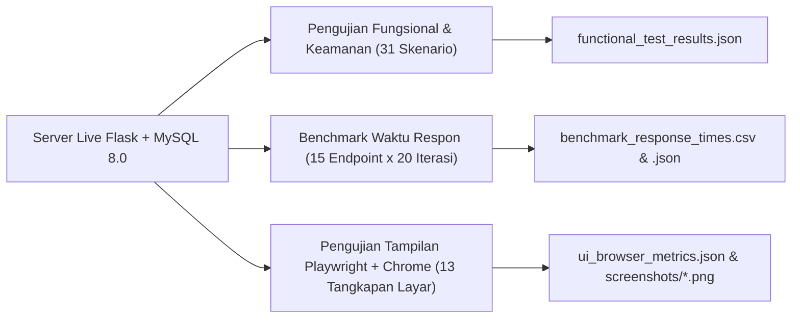
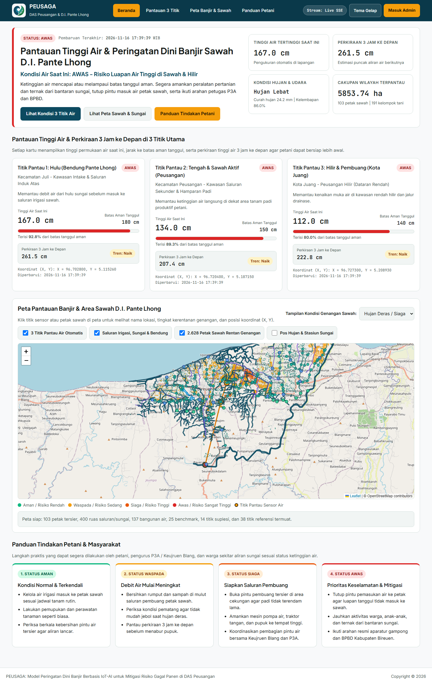
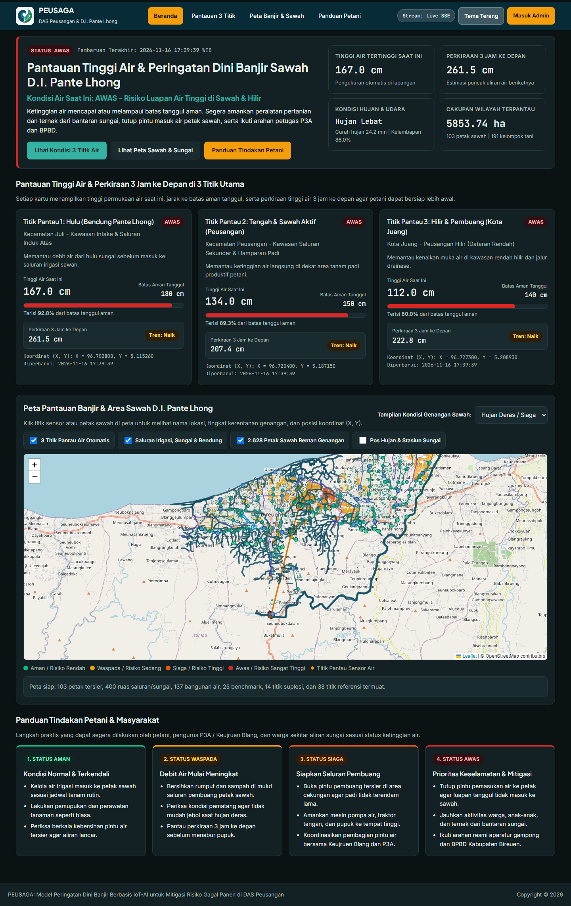
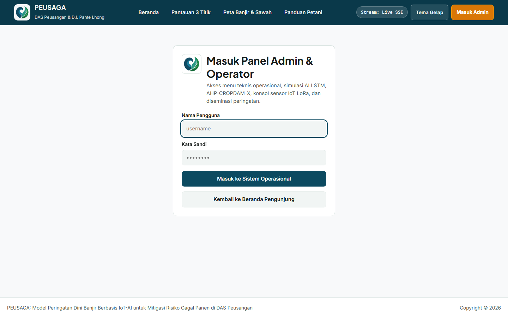
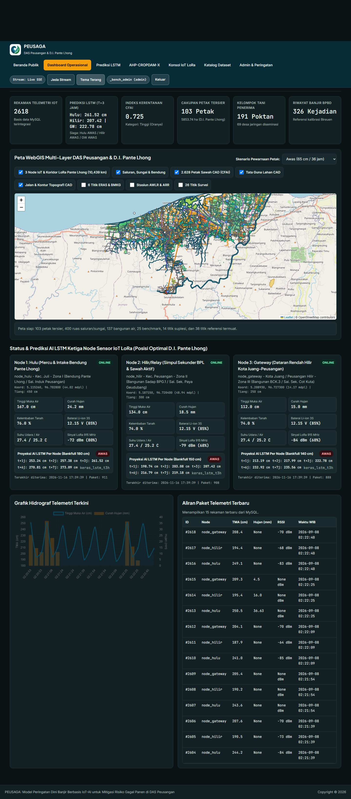
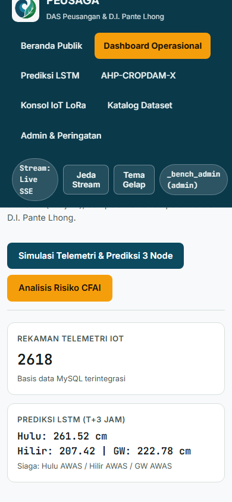
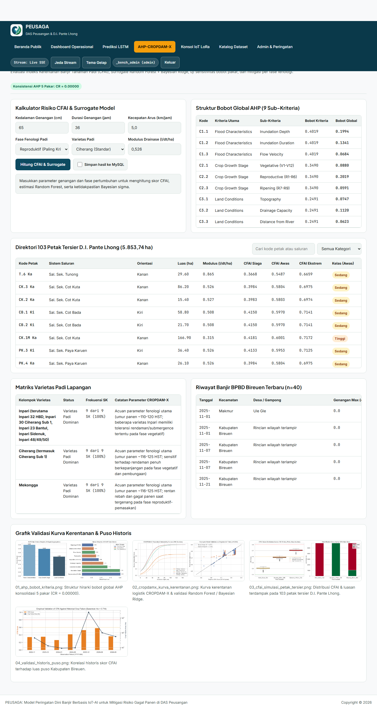

# Laporan Pengujian Sistem PEUSAGA Fullstack

- **Waktu Eksekusi**: 2026-11-16 17:41:03 WIB
- **Lingkungan Pengujian**: Python 3.12, Flask + SQLAlchemy, MySQL 8.0, TensorFlow/Keras, Leaflet `L.canvas()`, Google Chrome Headless
- **Ringkasan Kelulusan Fungsional**: **31/31 Kasus Uji LULUS** (`exit_code=0`, durasi `11.72 detik`)

## 1. Arsitektur Alur Pengujian Sistem

Metrik persentil ke-95 ($P_{95}$) untuk distribusi waktu respon $L = \{l_1, l_2, \dots, l_n\}$ yang telah diurutkan dihitung menggunakan interpolasi linier:

$$P_{95} = l_{\lfloor k \rfloor} + (k - \lfloor k \rfloor) \cdot (l_{\lceil k \rceil} - l_{\lfloor k \rfloor}), \quad k = 0.95 \cdot (n - 1)$$

## 2. Hasil Benchmark Waktu Respon (N = 20 Iterasi per Endpoint)
| Metode | Endpoint | Deskripsi | HTTP | Payload | Min (ms) | Rata-rata (ms) | Median (ms) | P95 (ms) | Maks (ms) |
| :--- | :--- | :--- | :---: | :---: | :---: | :---: | :---: | :---: | :---: |
| `GET` | `/` | Landing Page Publik | `200` | 18,268 B | 20.82 | **24.20** | 23.58 | 29.50 | 40.17 |
| `GET` | `/login` | Halaman Login Admin | `200` | 21,977 B | 26.46 | **28.81** | 28.70 | 32.02 | 32.75 |
| `GET` | `/api/status` | API Publik Status 3 Node | `200` | 6,052 B | 10.04 | **11.21** | 11.06 | 12.31 | 12.88 |
| `GET` | `/api/gis/layers` | API WebGIS (103 Blok + 2.628 Sawah CAD) | `200` | 3,009,254 B | 108.54 | **121.45** | 116.60 | 140.82 | 164.56 |
| `GET` | `/api/gis/cad-extras` | API Lazy-Load CAD Sekunder | `200` | 4,718,341 B | 214.13 | **227.52** | 226.67 | 236.76 | 243.55 |
| `GET` | `/dashboard` | Dashboard Operasional WebGIS | `200` | 21,977 B | 20.28 | **21.82** | 21.60 | 23.20 | 23.28 |
| `GET` | `/ai-lstm` | Halaman Prediksi AI-LSTM | `200` | 47,726 B | 15.91 | **18.36** | 18.25 | 20.75 | 21.33 |
| `GET` | `/cropdamx` | Halaman Analisis AHP-CROPDAM-X | `200` | 73,564 B | 15.85 | **17.15** | 17.13 | 18.85 | 19.07 |
| `GET` | `/console` | Halaman Konsol Teknis & LoRa | `200` | 61,160 B | 16.45 | **18.07** | 17.90 | 20.75 | 21.52 |
| `GET` | `/datasets` | Halaman Katalog Dataset | `200` | 189,425 B | 958.42 | **1026.50** | 1020.55 | 1083.88 | 1165.69 |
| `GET` | `/admin` | Halaman Administrasi & Kalibrasi | `200` | 36,015 B | 12.24 | **13.55** | 12.95 | 16.12 | 16.18 |
| `GET` | `/api/telemetry?limit=50` | API Telemetri Historis (50 baris) | `200` | 16,109 B | 9.76 | **10.36** | 10.28 | 11.00 | 11.00 |
| `POST` | `/api/predict` | API Inferensi Keras LSTM (node_hulu) | `200` | 362 B | 65.63 | **72.11** | 70.98 | 83.02 | 87.03 |
| `POST` | `/api/risk/cropdamx` | API Evaluasi & Surrogate AHP-CROPDAM-X | `200` | 1,456 B | 35.24 | **37.85** | 37.50 | 41.07 | 43.04 |
| `POST` | `/api/lora/link-budget` | API Kalkulator Link Budget LoRa | `200` | 300 B | 5.69 | **6.12** | 6.11 | 6.47 | 6.59 |

## 3. Hasil Pengujian Fungsional, Keamanan, AI & WebGIS
| No | Kasus Uji | Status | Rincian Hasil |
| :---: | :--- | :---: | :--- |
| 1 | Logo PNG Transparan | **PASS** | size=(512, 512), mode=RGBA, corner_alpha=0 |
| 2 | MySQL Baseline Seeding | **PASS** | parcels=103 (5853.74 ha), telemetry=2618, flood_events=326 |
| 3 | Posisi Baru 3 Node Pante Lhong | **PASS** | coords_ok=True, old_pos_count=0 |
| 4 | Prediksi Historis & Keras 3 Node | **PASS** | total_per_node={'node_gateway': 871, 'node_hilir': 873, 'node_hulu': 2859}, keras_per_node={'node_gateway': 1, 'node_hilir': 1, 'node_hulu': 111} |
| 5 | HTML Route / | **PASS** | HTTP 200, h1=1, emdash=False, svg=False, clean=True |
| 6 | Landing Page Humanize & Pemisahan Menu Pengunjung | **PASS** | humanized=True, admin_menu_leaked=False |
| 7 | HTML Route /login | **PASS** | HTTP 200, h1=1, emdash=False, svg=False, clean=True |
| 8 | Route Guard & Proteksi API Tanpa Login | **PASS** | redirects_302=True, unauth_api=[401,401,401,401] |
| 9 | API Publik Landing Page (/api/status) | **PASS** | HTTP=200, nodes=3, overall=AWAS |
| 10 | Ingesti JSON /api (Tanpa Login Browser) | **PASS** | {'alert_level': 'AWAS', 'cfai_score': 0.2767, 'node_id': 'node_hulu', 'pred_plus_3h_cm': 179.87, 'risk_category': 'Rendah', 'status': 'ok', 'timestamp': '2026-11-16 17:39:35', 'water_level_cm': 157.4} |
| 11 | Ingesti Arduino CSV /api_ews.php | **PASS** | {'alert_level': 'SIAGA', 'cfai_score': 0.2767, 'node_id': 'node_hilir', 'pred_plus_3h_cm': 134.51, 'risk_category': 'Rendah', 'status': 'ok', 'timestamp': '2026-11-16 17:39:37', 'water_level_cm': 120.0} |
| 12 | Karantina SOS & Auth Hardware | **PASS** | SOS HTTP=202, Invalid HTTP=401 |
| 13 | Autentikasi Login Admin (/login) | **PASS** | bad=401, good_redirect=/dashboard |
| 14 | HTML Route /dashboard | **PASS** | HTTP 200, h1=1, emdash=False, svg=False, clean=True |
| 15 | Navbar Admin Setelah Login | **PASS** | Menu operasional dan tombol Keluar tampil saat sesi admin aktif |
| 16 | HTML Route /ai-lstm | **PASS** | HTTP 200, h1=1, emdash=False, svg=False, clean=True |
| 17 | HTML Route /cropdamx | **PASS** | HTTP 200, h1=1, emdash=False, svg=False, clean=True |
| 18 | HTML Route /console | **PASS** | HTTP 200, h1=1, emdash=False, svg=False, clean=True |
| 19 | HTML Route /datasets | **PASS** | HTTP 200, h1=1, emdash=False, svg=False, clean=True |
| 20 | HTML Route /admin | **PASS** | HTTP 200, h1=1, emdash=False, svg=False, clean=True |
| 21 | Keras LSTM & Simulasi 3 Node | **PASS** | t+3h={'node_hulu': 178.77, 'node_hilir': 136.85, 'node_gateway': 225.55}, sim_all=3 node |
| 22 | AHP-CROPDAM-X & Surrogate | **PASS** | CFAI=0.5901, RF=0.598, sigma=0.5747 |
| 23 | Filter Petak Tersier | **PASS** | matched=3 |
| 24 | WebGIS Multi-Layer Payload | **PASS** | iot_nodes=3, parcels=103, cad_sawah=2628, structures=137, channels=400, boundaries=364 |
| 25 | WebGIS CAD Extras Lazy-Load | **PASS** | status=200, pemukiman=1423, roads=1301 |
| 26 | Webhook Broadcast Dry-Run | **PASS** | SIMULATED OK |
| 27 | Kalkulator Teknik LoRa & Daya | **PASS** | RSSI=-98.68 dBm, autonomy=84.8h |
| 28 | Dataset Preview & Path Guard | **PASS** | csv=200, traversal_blocked=400, chart=200 |
| 29 | Logout Menghapus Sesi | **PASS** | logout=302, post_logout_dashboard=302 |
| 30 | Koordinat (X, Y) Peta WebGIS | **PASS** | Fungsi & label koordinat X/Y geografis + UTM 47N tersedia pada seluruh layer peta |
| 31 | Higienitas Kode & Keamanan Path | **PASS** | Bersih |

## 4. Metrik Antarmuka Browser & Responsivitas
| Berkas Tangkapan Layar | Halaman / Skenario | Viewport | Tema | DOM Ready (ms) | Load (ms) | Overflow (px) | Ukuran |
| :--- | :--- | :--- | :---: | :---: | :---: | :---: | :---: |
| `01_landing_light_desktop.png` | Landing Page Publik (Terang) | Desktop 1440x900 | Light | 349 | 603 | 0 | 1006.7 KB |
| `02_landing_dark_desktop.png` | Landing Page Publik (Gelap) | Desktop 1440x900 | Dark | 349 | 603 | 0 | 1017.5 KB |
| `04_login_desktop.png` | Halaman Login Admin | Desktop 1440x900 | Light | 45 | 45 | 0 | 70.3 KB |
| `03_landing_mobile.png` | Landing Page Publik (Mobile) | Mobile 390x844 | Light | 253 | 384 | 0 | 67.1 KB |
| `05_dashboard_light_desktop.png` | Dashboard WebGIS (2.628 Sawah CAD) | Desktop 1440x900 | Light | 215 | 219 | 0 | 1094.4 KB |
| `06_dashboard_cad_extras_desktop.png` | Dashboard WebGIS (Lapisan CAD Lengkap) | Desktop 1440x900 | Light | 215 | 219 | 0 | 567.1 KB |
| `07_dashboard_dark_desktop.png` | Dashboard WebGIS (Tema Gelap) | Desktop 1440x900 | Dark | 215 | 219 | 0 | 1139.9 KB |
| `08_dashboard_mobile.png` | Dashboard WebGIS (Mobile) | Mobile 390x844 | Light | 70 | 72 | 192 | 57.1 KB |
| `09_ai_lstm_desktop.png` | Modul Prediksi AI-LSTM (3 Node) | Desktop 1440x900 | Light | 79 | 80 | 0 | 663.2 KB |
| `10_cropdamx_desktop.png` | Modul Risiko AHP-CROPDAM-X | Desktop 1440x900 | Light | 63 | 64 | 0 | 452.6 KB |
| `11_console_desktop.png` | Konsol Teknis & Link Budget LoRa | Desktop 1440x900 | Light | 57 | 58 | 0 | 511.2 KB |
| `12_datasets_desktop.png` | Katalog Dataset & Artefak Riset | Desktop 1440x900 | Light | 1180 | 1180 | 0 | 889.1 KB |
| `13_admin_desktop.png` | Administrasi Node, Poktan & Audit | Desktop 1440x900 | Light | 48 | 50 | 0 | 245.1 KB |

## 5. Dokumentasi Tangkapan Layar Antarmuka
### Landing Page Publik (Terang) (Desktop 1440x900, Light)

### Landing Page Publik (Gelap) (Desktop 1440x900, Dark)

### Halaman Login Admin (Desktop 1440x900, Light)

### Landing Page Publik (Mobile) (Mobile 390x844, Light)

### Dashboard WebGIS (2.628 Sawah CAD) (Desktop 1440x900, Light)

### Dashboard WebGIS (Lapisan CAD Lengkap) (Desktop 1440x900, Light)

### Dashboard WebGIS (Tema Gelap) (Desktop 1440x900, Dark)

### Dashboard WebGIS (Mobile) (Mobile 390x844, Light)

### Modul Prediksi AI-LSTM (3 Node) (Desktop 1440x900, Light)

### Modul Risiko AHP-CROPDAM-X (Desktop 1440x900, Light)

### Konsol Teknis & Link Budget LoRa (Desktop 1440x900, Light)

### Katalog Dataset & Artefak Riset (Desktop 1440x900, Light)

### Administrasi Node, Poktan & Audit (Desktop 1440x900, Light)

